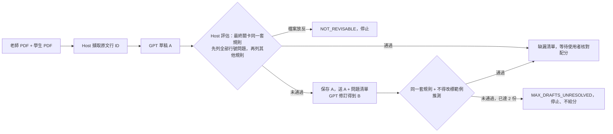

# Week 6：PDF 預檢改成評估後修訂（Evaluator–optimizer）

第 02 組，題目沿用「以教師範例為參考的作業規格與完成度檢查助手」。

> 我們在原專案的 **PDF 預檢**子流程，用 **Evaluator–optimizer** workflow 處理「Host 只回報第一個錯、模型無法依錯誤位置修正，整份預檢就作廢」的問題；離線案例可修訂後通過，真實環境**尚未證明改善**，預設維持原版。證據在本頁與 [artifacts/week6](../../artifacts/week6/)。

- 原使用者故事：學生提交前上傳老師規格與自己的報告 PDF，先看缺漏、待確認與修改建議；老師配分明確時，核對配分後才看預估區間。業務終點維持 `POST /assistant/week7/pdf/precheck`（產生預檢）與 `.../confirm`（核對配分、顯示區間）。
- Repository：https://github.com/yoyo6108876/nutn-agent-2026f-team2-campus-life，分支 `codex/week6-evaluator-optimizer`（目前只在本機，推送後才有提交連結）。
- 基線：`33b948fc51066cdcf570184067f1a498ba313a28`（PDF 預檢 v0.8，單次呼叫）。
- 候選：`327b7e2cb68c36dc0c327eaf02832ee80260907b`（第一輪真實比較用 `c0403a3024a849c7a3c0aa56a75792ede1f44e4c`，之後依失敗修正修訂回饋）。
- [ADR](adr.md) · [前後比較](comparison.md) · [固定輸入](../../examples/week6/README.md) · [證據](../../artifacts/week6/)

| 項目 | 實際狀態 |
| --- | --- |
| 正常主流程（gpt-5.4，`c0403a3` 與 `327b7e2` 各一輪） | 原版、候選四次皆 `LIVE_PASS`（HTTP 200、通過 Host 核對），候選都是第一份就通過、呼叫次數相同；但預先寫定的 7 項業務預期四次都只符合 6 項（腳本 `passed=false`），都把「終端機輸出不是截圖」誤判為已完成 |
| 輕量模型（gpt-4.1-mini，兩輪） | 兩版皆 `LIVE_FAIL`；候選的真實修訂兩次都與草稿 A 逐字相同，到上限停止，tokens 約為原版 2.3 倍 |
| 服務拒絕 | 真實請求（不存在的模型名稱）三輪與注入逾時皆有限停止、如實回報錯誤 |
| 離線案例 | 15 個全部符合預期；213 項測試通過（本週 35 項） |
| 結論 | **尚未證明改善**，預設維持原版，候選可切換 |
| Google Cloud／ADC Gemini | `LIVE_NOT_RUN`，依組員選擇使用 OpenAI，課程此項尚未達成 |

## 開工契約

| 欄位 | 內容 |
| --- | --- |
| 原流程與缺口 | [`pdf_review.py`](../../assignment_checker/pdf_review.py) 的 `PDFReviewProvider.generate` 呼叫模型一次，接著 `resolve_draft` → `validate_report` 核對，遇到第一個錯誤就丟出 `CheckFailure`，API 回 502、不給分。固定輸入為 [examples/week6](../../examples/week6/) 的老師／學生 PDF。原結果（`workflow=single`）：gpt-5.4 回 200，業務預期 6／7；gpt-4.1-mini 回 502 `INVALID_SOURCE_REFERENCE`，7 項文字證據的 `observation` 也填了說明。背景：v0.8 開發期間以 gpt-4.1-mini 與非公開 PDF 的真實執行也是 `LIVE_FAIL`（`ae1a441` 模型自寫引文 `UNGROUNDED_PDF_REPORT`；`a9010bf` 跨頁或過長的行號範圍 `INVALID_SOURCE_REFERENCE`）。錯在模型輸出的證據欄位，Host 只回報第一個錯，模型沒有機會依錯誤位置修正。 |
| 選定 workflow | Evaluator–optimizer。Host 能精確指出哪一項、哪條規則、哪個行號範圍錯，模型能據此重選，符合「評估回饋後修訂」。本週只改「模型草稿 → Host 核對」這一段；上傳、擷取、配分確認、Session 與儲存都不變。 |
| 執行與資訊契約 | 輸入 state：兩份已解析 PDF（原文行 ID + 頁面圖片）。草稿 A → `evaluate_draft(A)` 得到 `issues`（`code`、`rule`、`where`、`reference`、`message`，欄位混用時另有 `fix`）；先列出全部行號問題，行號全部正確後再列配分與證據規則。下一步條件：`issues` 為空就採用；有 `document_roles` 就停；其餘情況把 A 與 `issues` 送回模型得到 B，B 用同一套規則加「不得把範例推測改成明確要求」重評。修訂呼叫需要：同一份系統提示、原文行、兩份 PDF、A、`issues`。不需要也不送：Session 記憶、身分、其他 run、評估程式、PDF 文字以外的使用者資料。輸出 state：`workflow` trace（每份草稿的評估結果、狀態統計、呼叫紀錄、停止原因）。 |
| Scaffold 與停止 | 由後端 [`week6/workflow.py`](../../assignment_checker/week6/workflow.py) 的 `revise_until_valid` 執行，`PDFPrechecks.start` 依 `PDFPair.workflow` 選擇。上限 `MAX_DRAFTS=2`。停止原因：`PASSED_FIRST_DRAFT`、`PASSED_AFTER_REVISION`、`MAX_DRAFTS_UNRESOLVED`、`NOT_REVISABLE`（檔案角色不符）、`PROVIDER_ERROR`、`DRAFT_UNUSABLE`、`CONFIGURATION_ERROR`。草稿拒絕碼沿用原本的 `INVALID_SOURCE_REFERENCE`、`UNGROUNDED_PDF_REPORT`、`PROVIDER_*`；新增 `WORKFLOW_UNAVAILABLE`（422），未知的 `workflow` 值在呼叫模型前以 422 拒絕。未通過不寫入紀錄、不給分。配分仍須使用者勾選確認才顯示區間。 |
| 驗收斷言 | Given 草稿 A 有跨頁與超出頁尾的行號，When 以候選流程送出，Then 第二次呼叫帶著 A 與 3 項位置明確的問題，B 通過同一套規則後才回 200，trace 停止原因為 `PASSED_AFTER_REVISION`；證據在 [4a_revision_recovers-evaluator_optimizer.json](../../artifacts/week6/fixture/4a_revision_recovers-evaluator_optimizer.json)。Given 兩份草稿都未通過，When 第三份可通過的草稿仍在佇列，Then 只呼叫 2 次並停止、不給分；證據在 [4b_limit_stops-evaluator_optimizer.json](../../artifacts/week6/fixture/4b_limit_stops-evaluator_optimizer.json)。 |



## 程式差異與執行

```sh
git diff 33b948f 327b7e2 -- assignment_checker tests scripts examples/week6
```

| 檔案 | 改了什麼 |
| --- | --- |
| [`pdf_review.py`](../../assignment_checker/pdf_review.py) | 把核對規則拆成 `copy_sources`（可列出全部行號錯誤）與 `report_issues`（依原順序產生每條規則違反）。`resolve_draft`、`validate_report` 仍在第一個錯誤停止，原版行為不變。新增 `evaluate_draft`、`single_pass`、`PDFPair.workflow`，provider 拆出 `draft()` 以便附加修訂回合。 |
| [`week6/workflow.py`](../../assignment_checker/week6/workflow.py)、[`revision_prompt.txt`](../../assignment_checker/week6/revision_prompt.txt) | 評估後修訂迴圈、停止原因、修訂契約與 trace。 |
| [`service.py`](../../assignment_checker/service.py) | `CheckFailure` 可帶 `workflow` trace，失敗時回應也看得到停止原因。 |
| [`week7/routes.py`](../../assignment_checker/week7/routes.py)、[`week7/ui.html`](../../assignment_checker/week7/ui.html) | 註冊候選流程；PDF 面板加「比對流程」選單，顯示每份草稿結果、呼叫次數、修訂改變與停止原因。 |
| [`tests/test_week6_workflow.py`](../../tests/test_week6_workflow.py)、[`scripts/run_week6_comparison.py`](../../scripts/run_week6_comparison.py) | 35 項新測試與前後比較腳本。 |

在 [本機工作台](http://127.0.0.1:8000/week7) 選示範身分 → PDF 預檢與估分 → 選兩份 PDF → 「比對流程」選原版或候選。API 直接在 body 加 `"workflow": "evaluator_optimizer"`；不帶時為原版 `single`。

```sh
.venv/bin/python -m uvicorn assignment_checker.api:app --host 127.0.0.1 --port 8000
# 全部回歸測試（213 項）
.venv/bin/python -m pytest tests/test_environment.py tests/test_assignment_api.py tests/test_assignment_provider.py tests/test_week3_retrieval.py tests/test_week4_tools.py tests/test_week5_orchestration.py tests/test_week5_comparison.py tests/test_week7_memory.py tests/test_pdf_review.py tests/test_week6_workflow.py -q
# 離線案例：只把 OpenAI SDK 換成固定草稿或注入錯誤，不呼叫模型
.venv/bin/python -m scripts.run_week6_comparison --output-dir tmp/week6/fixture
# 真實比較：使用 OpenAI 額度；輸入檔未提交時會拒絕執行
.venv/bin/python -m scripts.run_week6_comparison --live --output-dir tmp/week6/live
```

## 四條必備案例與寫入重送

預期在執行前寫進比較腳本，每個 JSON 的 `expected` 與 `actual` 分開保存，`details` 另存完整觀測值。離線案例只替換 OpenAI SDK，標 `LIVE_NOT_RUN`；注入錯誤與真實請求分開列。

| 案例 | 預期（先寫） | 實際 | 證據 |
| --- | --- | --- | --- |
| 1 正常主流程（真實） | 200；辨識 100 分配分 40／20／20／20；標出缺標準差、缺改進方向、終端機輸出非截圖三處；確認後有區間 | 候選 SHA `327b7e2`、gpt-5.4：原版 200 `LIVE_PASS`，業務預期 6／7，run `pdf-2c528c53…`，區間 50–72；候選 200 `LIVE_PASS`，第一份即通過，6／7，run `pdf-8d2295b9…`，區間 46–73。`c0403a3` 結果相同（6／7）。四次都把終端機截圖誤判為已完成，腳本記為 `passed=false`。提示 `pdf-precheck-v2-source-lines`。課程要求的真實 Gemini：`LIVE_NOT_RUN` | [原版](../../artifacts/week6/live-327b7e2-gpt54/1_normal_live-single-gpt-5.4-2026-03-05.json)、[候選](../../artifacts/week6/live-327b7e2-gpt54/1_normal_live-evaluator_optimizer-gpt-5.4-2026-03-05.json)、[第 1 輪](../../artifacts/week6/live-c0403a3/) |
| 1 正常主流程（離線） | 200、1 次呼叫、寫入 1 筆、確認前不顯示分數 | 兩版皆符合 | [原版](../../artifacts/week6/fixture/1_normal-single.json)、[候選](../../artifacts/week6/fixture/1_normal-evaluator_optimizer.json) |
| 2 非法輸入 | 同一 Session 先成功一次，再送非 PDF 內容：422 `INVALID_PDF`，拒絕點 `pdf_input`，下游模型 0 次、寫入 0 筆，不回傳上一次的 run | 兩版皆符合 | [原版](../../artifacts/week6/fixture/2_invalid_input-single.json)、[候選](../../artifacts/week6/fixture/2_invalid_input-evaluator_optimizer.json) |
| 3 Provider 失敗（注入） | 第 1 次呼叫逾時：504 `PROVIDER_UNAVAILABLE`，1 次即停，排隊中的正確草稿不使用；候選在修訂呼叫逾時：504，2 次，`PROVIDER_ERROR` | 皆符合 | [原版](../../artifacts/week6/fixture/3_provider_timeout-single.json)、[候選](../../artifacts/week6/fixture/3_provider_timeout-evaluator_optimizer.json)、[修訂逾時](../../artifacts/week6/fixture/3b_timeout_on_revision-evaluator_optimizer.json) |
| 3 Provider 失敗（真實） | 不存在的模型名稱：502 `PROVIDER_ERROR`，錯誤來源 `provider`，1 次，寫入 0 筆 | 兩版三輪皆符合；tokens 未取得 | [原版](../../artifacts/week6/live-327b7e2-gpt54/3_provider_rejects_live-single-gpt-week6-model-does-not-exist.json)、[候選](../../artifacts/week6/live-327b7e2-gpt54/3_provider_rejects_live-evaluator_optimizer-gpt-week6-model-does-not-exist.json) |
| 4 Workflow 邊界：未達標且到上限停止 | A、B 都未通過，第 3 份正確草稿仍在佇列：恰好 2 次呼叫，502 `INVALID_SOURCE_REFERENCE`，停止原因 `MAX_DRAFTS_UNRESOLVED`，不寫入、不給分，trace 列出兩份草稿的評估結果 | 符合，第 3 份未使用。真實 gpt-4.1-mini 候選兩輪也都在第 2 份後停止（`LIVE_FAIL`） | [離線](../../artifacts/week6/fixture/4b_limit_stops-evaluator_optimizer.json)、[真實第 1 輪](../../artifacts/week6/live-c0403a3/1_normal_live-evaluator_optimizer-gpt-4.1-mini-2025-04-14.json)、[第 2 輪](../../artifacts/week6/live-327b7e2-mini/1_normal_live-evaluator_optimizer-gpt-4.1-mini-2025-04-14.json) |
| 4 補充：修訂成功、檔案放反、改標推測 | A 有 3 項行號錯誤、B 正確：候選 200、2 次；原版 502、1 次。A 判斷檔案放反（含同時有行號錯誤）：1 次即停 `NOT_REVISABLE`。B 把範例推測改標為明確要求：拒絕 | 皆符合 | [修訂成功](../../artifacts/week6/fixture/4a_revision_recovers-evaluator_optimizer.json)、[檔案放反](../../artifacts/week6/fixture/4c_roles_with_bad_ref_not_revised-evaluator_optimizer.json)、[改標](../../artifacts/week6/fixture/4d_relabel_rejected-evaluator_optimizer.json) |
| 5 寫入重送 | 同一 run ID（即 request id）重送配分確認：兩次結果相同（42–70），`confirmed_at` 不變，模型 0 次，紀錄仍為 1 筆 | 兩版皆符合 | [原版](../../artifacts/week6/fixture/5_confirm_resend-single.json)、[候選](../../artifacts/week6/fixture/5_confirm_resend-evaluator_optimizer.json) |

## 證據索引

| 證據 | 位置 |
| --- | --- |
| 請求 | 固定輸入 [examples/week6](../../examples/week6/)；請求 body 為兩份 PDF 加 `workflow` |
| 實際呼叫 | 每個真實案例 JSON 的 `calls`：第幾次、是否為修訂回合、response ID、tokens、耗時 |
| 檢查／確認 | `details.draft_results`（每份草稿的通過與否、問題數、規則、狀態統計、是否與上一份相同）；確認配分見案例 5 |
| 結果 | `body`（API 回應原文，合成資料）與 `drafts`（模型草稿原文） |
| 回送 | 離線案例 [4a](../../artifacts/week6/fixture/4a_revision_recovers-evaluator_optimizer.json) 的 `revision_request`：回合順序、重送的 PDF、草稿 A 是否原樣送回、送出的問題清單。真實修訂只記錄 `calls[1].revision_turns` 與錯誤回應中的 `workflow.drafts[0].issues`，完整請求未擷取 |
| 摘要 | [fixture/summary.json](../../artifacts/week6/fixture/summary.json)、[live-c0403a3/summary.json](../../artifacts/week6/live-c0403a3/summary.json)、[live-327b7e2-mini/summary.json](../../artifacts/week6/live-327b7e2-mini/summary.json)、[live-327b7e2-gpt54/summary.json](../../artifacts/week6/live-327b7e2-gpt54/summary.json)、[pytest.txt](../../artifacts/week6/pytest.txt)（含受測 SHA） |

真實紀錄以腳本產生後直接保存，沒有編修內容；每個檔案記錄受測 SHA、相關檔案 sha256 與未提交清單。腳本在相關檔案未提交時拒絕執行真實比較。各輪 `summary.json` 的 `passed` 是 7 項業務預期是否全部符合，`live_status` 是真實請求是否成功。離線案例 2 的 `responded_calls`／`unmeasured_calls` 是同一 Session 先前成功那次的累計值，這次請求的下游呼叫數以 `provider_calls: 0` 為準。

## 已知問題與補驗證

| 狀態 | 範圍 |
| --- | --- |
| `LIVE_PASS` | gpt-5.4 正常主流程的真實請求，原版與候選在 `c0403a3`、`327b7e2` 各一次；只有一組合成 PDF，且 7 項業務預期四次都只符合 6 項 |
| `LIVE_FAIL` | gpt-4.1-mini 正常主流程，原版與候選各兩次（`c0403a3`、`327b7e2`）；其中候選的真實修訂路徑兩次（修訂稿與 A 相同）；不存在模型名稱的服務拒絕三輪（刻意製造） |
| `LIVE_NOT_RUN` | 欄位層級 `fix` 實際送出的修訂（第 2 輪草稿 A 沒有欄位混用）；真實學生 PDF；Google Cloud／ADC Gemini |

「修訂後通過」目前只在離線案例出現，真實環境尚未觀察到。

- **語意錯誤擋不住。** 學生 PDF 第 2 頁只有程式截圖與文字形式的終端機輸出，gpt-5.4 四次都寫出不存在的終端機截圖（例如原版「本頁截圖可見終端機輸出畫面」、候選「本頁截圖可見執行結果/終端機輸出內容」）。Host 只核對頁碼，圖像觀察的內容無法驗證，兩種流程都放行。
- **輕量模型原樣重送。** 兩輪修訂稿都與草稿 A 相同。第 2 輪草稿 A 只有 1 項配分引用錯誤，送出的是一般訊息，欄位層級的 `fix` 沒有送出，所以它的效果尚未取得。
- **回饋只到第一層。** 行號錯誤與其他規則分兩階段檢查：行號全部正確後，才會檢查配分與證據規則。若草稿兩種錯誤都有，一次修訂只會看到行號問題。
- **候選的失敗代價較高。** 失敗時重送兩份 PDF 的頁面圖片，tokens 約為原版 2.3 倍。
- 示範登入仍是合成身分，不是正式認證；Windows 需使用 WSL（Session 鎖使用 POSIX `fcntl`）。

補驗證步驟：

1. 把草稿 A 改放在 user 訊息中當作待修正資料，以 gpt-4.1-mini 重跑本頁的真實比較，看修訂稿是否仍與 A 相同；遇到欄位混用時記錄 `fix` 是否送出、是否被採納。
2. 準備 3 組以上合成 PDF（含會讓模型選錯行號的版面），兩版每組各跑 5 次，比較通過率、tokens 與耗時。
3. 取得課程 Google Cloud／ADC 設定後，以 Gemini 重跑案例 1 與案例 3。

## 離堂檢查

| 檢查 | 回答 |
| --- | --- |
| 原題目延續 | 原使用者故事與 repo 見本頁開頭，PDF 預檢端點與確認流程不變。 |
| Workflow 增量 | Evaluator–optimizer。真正改變執行的是 [`week6/workflow.py`](../../assignment_checker/week6/workflow.py) 與 [`pdf_review.py`](../../assignment_checker/pdf_review.py) 的 `evaluate_draft`／`PDFPrechecks.start`。 |
| 證據足夠 | 四條案例與第 5 條見上表，比較表見 [comparison.md](comparison.md)，ADR 見 [adr.md](adr.md)，原始 JSON 見 [artifacts/week6](../../artifacts/week6/)。提交連結要等分支推送後補上。 |
| 狀態誠實 | 離線案例一律 `LIVE_NOT_RUN`；真實失敗保留為 `LIVE_FAIL`，沒有重跑挑選結果；`LIVE_PASS` 一律附上業務預期 6／7。Gemini／ADC 為 `LIVE_NOT_RUN`。 |
| 安全與後續 | 只用合成 PDF，證據中沒有金鑰、`.env`、真實學生資料或本機絕對路徑。補驗證步驟見上一節。 |

來源：課程 Lecture06（Week 06 各組原期末專案 workflow 增量，投影片 60–68）。程式與文件由 Claude Code 協助實作，團隊須自行核對評閱結果與理解系統邊界。
