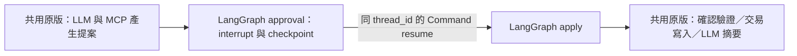

# Week 5：局部替換確認流程的編排

本組沿用「作業規格與缺漏檢查助手」及 OpenAI，選擇講義的 **LangGraph 等待與接續** 路徑。候選接回原來的補件工作台與 API，只替換確認階段的暫停／接續；讀報告、模型工具往返、業務驗證與寫入工具仍共用 Week 4 程式。

原版基準為 commit `9535ccb9d7b921004925c46d2aa61adc5065c8de`。實驗分支 `codex/week5-langgraph`；受測版本、前後比較與 live 狀態見 [驗收紀錄](validation.md)，採用理由見 [一頁重構決策](decision.md)。

## 啟動與切換

每台電腦都需自行建立環境，不能複製別人的 `.venv`。已在 macOS / Python 3.14 實測；Linux、Windows WSL 可使用下列相同指令，但未在本次逐平台驗證。候選的跨程序鎖使用 `fcntl`，**Windows 原生 Python 尚不支援候選，請使用 WSL**。

```sh
python3 -m venv .venv
.venv/bin/python -m pip install -r requirements-lock.txt
# 首次設定才複製；已有 .env 不要覆蓋
test -f .env || cp .env.example .env
.venv/bin/python -m uvicorn assignment_checker.api:app --host 127.0.0.1 --port 8000
```

本機 `.env` 沿用 `OPENAI_API_KEY`／`OPENAI_MODEL`，不提交金鑰、不新增 provider。選離線示範不需要 key；真實 AI 模式會使用 OpenAI API 額度。

開啟 **http://127.0.0.1:8000/week5**（原 `/week4` 也可），展開「Week 5 比較設定」：

1. 「原版：手刻流程」為預設，維持 Week 4 行為。
2. 「候選：LangGraph 等待與接續」會在草稿提案後建立持久 checkpoint、停在 `interrupt()`。
3. 模式選離線示範或 OpenAI 實際 AI，按準備補件清單，查看具體項目再確認／取消。
4. 重新整理會恢復 run 與模式；「查看執行紀錄與來源引用」可查 `thread_id`、checkpoint ID、interrupt、模型與工具紀錄。

兩版仍使用固定 `HW-DEMO-01 / SUB-DEMO-01 / v1` 合成資料。任意 PDF 上傳、真實學生評閱、平台通知與多人權限隔離不在這次重構範圍。

## 保留／替換／轉接

| 類型 | 位置 | 這次處理 |
| --- | --- | --- |
| 保留 | [Week 4 Workflow.start](../../assignment_checker/week4/workflow.py) | 模型讀取提案、MCP、來源 gate、模型草稿提案；原檔保持不變 |
| 替換 | 原 Workflow.start 返回 pending、Workflow.decide 直接接決定的編排 | [GraphWorkflow](../../assignment_checker/week5/workflow.py) 的 `StateGraph`：approval → apply → END；`interrupt`＋SQLite checkpoint＋相同 thread 的 `Command(resume=...)` |
| 保留 | Workflow.decide、[Store.decide](../../assignment_checker/week4/store.py) | 600 秒期限、來源重驗、拒絕不寫入、同一 request_id 原子交易；apply 節點呼叫既有業務處理 |
| 保留 | [provider](../../assignment_checker/week4/provider.py)、[prompt](../../assignment_checker/week4/prompt.txt) | 同一模型、提示版本、工具 schema、回合／重試上限與摘要事實核對 |
| 轉接 | [routes](../../assignment_checker/week4/routes.py)、[UI](../../assignment_checker/week4/ui.html) | 新請求指定 engine；舊請求依已保存的 engine 接續，不能用 URL 切換繞過 checkpoint |

候選的業務 SQLite 仍保存收據、audit 與對外結果；checkpoint 保存框架游標、待確認內容與 seal。這是兩套不同職責的儲存，沒有把 checkpoint 誤當成「外部寫入恰好一次」保證。



## API 與回退

同一端點 POST `/assistant/week4/runs?engine=baseline` 或 `?engine=langgraph`，JSON body 與 Week 4 相同。未指定 engine 時選原版。GET `/assistant/week4/runs/{run_id}` 可恢復請求；POST `/assistant/week4/runs/{run_id}/decision` 只接 `{"accepted":true}` 或 false。

回退方式是把**新請求**切回 baseline；已等待的候選仍須走原 checkpoint，不能就地轉為原版。刪除 checkpoint 會停止候選確認，不會自動降級寫入。本機資料位於被 Git 忽略的 `tmp/week4/state.sqlite3`、`tmp/week4/checkpoints.sqlite3`、`tmp/week4/resume-locks/`；正式多機部署尚未驗證。

候選透過作業系統檔案鎖排除同一 run 的同時接續；忙碌回傳 `409 RUN_BUSY`。框架最多 5 steps，原模型上限仍為 3 回合／每回合至多 2 attempts。checkpoint 無法讀取時不呼叫寫入工具；寫入已完成時優先回傳業務收據，重送不再呼叫模型摘要。

## 重跑相同案例

```sh
# 五組案例；每一步建立新的 Python 程序，真正重開兩個 SQLite
.venv/bin/python -m scripts.run_week5_comparison --output-dir tmp/week5-comparison

# 真實 OpenAI A/B：兩個正常案例，各版分別執行，正常合計 10 次模型呼叫
.venv/bin/python -m scripts.run_week5_comparison --live --output-dir tmp/week5-live

.venv/bin/python -m pytest tests/test_environment.py tests/test_assignment_api.py tests/test_assignment_provider.py tests/test_week3_retrieval.py tests/test_week4_tools.py tests/test_week5_orchestration.py tests/test_week5_comparison.py -q
```

比較保留完整原始 trace，只在跨版比對時正規化隨機 run/draft ID 與時間；同一請求的 replay 收據必須完全相同。錯誤情境明示故障注入，fixture 不標成 live；沒有用上一週的 OpenAI 歷史紀錄代替本週實測。

技術依據：[LangGraph interrupts](https://docs.langchain.com/oss/python/langgraph/interrupts)、[persistence](https://docs.langchain.com/oss/python/langgraph/persistence)。候選使用 `langgraph==1.2.15`、`langgraph-checkpoint-sqlite==3.1.2`。關閉 LangSmith trace 上傳，checkpoint 不啟用 pickle fallback。
